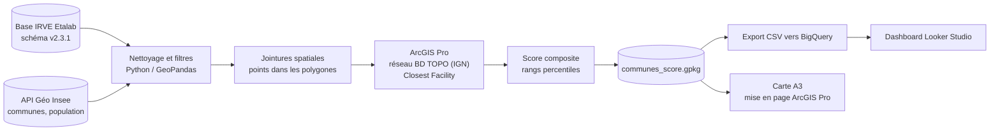

# ⚡ Zones de potentiel IRVE en Île-de-France

> Où implanter les prochaines bornes de recharge rapides (≥ 150 kW) ? Ce projet croise open data, SIG réseau et BI pour hiérarchiser les **1 266 communes d'Île-de-France** selon leur potentiel d'accueil d'infrastructures de recharge pour véhicules électriques.

**📋 Projet personnel réalisé en parallèle du Master 2 Géographies numériques (Université Lyon 2, Lyon 3 et Jean Monnet), en lien avec une candidature au CS27 « RGE-D / Renault » — référentiel géospatial et analyse des usages de la mobilité.**

## 🚀 Résultats en un coup d'œil


| Livrable                                                                                | Accès                                                                                         |
| --------------------------------------------------------------------------------------- | --------------------------------------------------------------------------------------------- |
| 🗺️ **Carte de synthèse A3** (choroplèthe communale, 5 classes)                         | [`docs/AMC_IRVE.pdf`](docs/AMC_IRVE.pdf)                                                      |
| 📊 **Dashboard interactif** (KPI, filtre département, seuil d'éloignement paramétrable) | [Looker Studio](https://datastudio.google.com/reporting/8da5f0e4-b1c3-4bf1-a26c-6cc4834aef5c) |
| 🧮 **Scripts** (acquisition, score composite, export)                                   | [`scripts/`](scripts/)                                                                        |


## 🎯 La question

La recharge rapide est le maillon critique de l'électrification : un automobiliste sans borne ≥ 150 kW à moins de 15 minutes de chez lui ne passera pas à l'électrique. Ce projet identifie les communes où le besoin est le plus criant, en combinant trois dimensions :

- **la demande** : population et densité (Insee) ;
- **l'éloignement** : temps de trajet routier jusqu'à la borne rapide la plus proche ;
- **l'offre existante** : points de charge pour 1 000 habitants.

## 🛠️ Pipeline



## 🧮 Le score composite

Pour chaque commune calculable :

```
score = ( rang(densité) + rang(temps de trajet) + (1 − rang(équipement)) ) / 3 × 100
```

Chaque dimension est transformée en **rang percentile** — le score est insensible aux distributions et aux unités, et donc robuste aux valeurs extrêmes. Les communes sans itinéraire calculable sont exclues et étiquetées « Non calculé » (57 cas initiaux, diagnostic et correction documentés dans la note méthodologique). 

## 🔍 Enseignements sur la donnée

Un projet géodata, c'est d'abord de la qualité de données. Trois découvertes documentées :

1. **Dater son extraction** : la base nationale IRVE est actualisée en continu — un comptage de points de charge n'a de sens que rapporté à sa date d'extraction. Le millésime utilisé ici (28/09/2026) est indiqué dans le dashboard et la note méthodologique.
2. **L'effet hub** : Coupvray (3 066 habitants) concentre **518 points de charge** — \~170 pour 1 000 habitants, record régional, porté par l'A4 et les parkings de Disneyland Paris. Un seul hub peut écraser la moyenne régionale : d'où des scores par rangs, pas des moyennes brutes.
3. **Compter à chaque étape** : jointures spatiales, appariement des itinéraires, exports — chaque maillon de la chaîne peut perdre ou dupliquer des entités en silence. Chaque script vérifie donc ses effectifs (1 266 communes attendues, contrôles par `assert`), et les communes non calculables sont étiquetées « Non calculé » plutôt que masquées : une entité perdue fausse tous les KPI en aval.

## 📁 Structure du dépôt

```
├── README.md                  # ce fichier
├── docs/
│   ├── AMC_IRVE.pdf           # carte de synthèse A3
│   └── note_methodo.md        # note méthodologique (à venir)
├── scripts/
│   ├── main.py                # 1. acquisition IRVE + communes, jointures, densités
│   ├── score_composite.py     # 2. score composite + classes (après Closest Facility dans ArcGIS Pro)
│   └── communes_analyses.py   # 3. export CSV → BigQuery / Looker Studio
├── requirements.txt
└── LICENSE
```

L'analyse réseau (jeu de données réseau construit sur le réseau routier de la BD TOPO de l'IGN, puis Closest Facility) est réalisée dans **ArcGIS Pro** entre les étapes 1 et 2 ; le temps de trajet par commune (`Total_temps`) arrive dans la table par jointure spatiale sur les points de départ des itinéraires.

## ▶️ Reproduire

```bash
pip install -r requirements.txt
python scripts/main.py             # données IRVE + fond communal (API Géo)
# … analyse réseau dans ArcGIS Pro (Closest Facility, bornes ≥ 150 kW) …
python scripts/score_composite.py  # score + classes
python scripts/communes_analyses.py # export CSV pour BigQuery
```

Les données sources sont publiques :

- **Base nationale IRVE consolidée** (Etalab, schéma statique v2.3.1) — [data.gouv.fr](https://www.data.gouv.fr/fr/datasets/fichier-consolide-des-bornes-de-recharge-pour-vehicules-electriques/)
- **API Géo** (communes, populations, contours) — [geo.api.gouv.fr](https://geo.api.gouv.fr)
- **BD TOPO®** (réseau routier du jeu de données réseau) — [geoservices.ign.fr](https://geoservices.ign.fr/bdtopo)

## 👤 Auteur

**Benjamin Meslin** — Master Géographies numériques, Université Lyon 2 · [GitHub](https://github.com/Benjamin-Meslin)

*Cartographie web, SIG, data géospatiale — du référentiel brut au livrable de décision.*

## 📄 Licence

[MIT](LICENSE) — les données sources restent sous leurs licences respectives (Etalab v2, licences ouvertes).